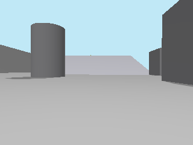
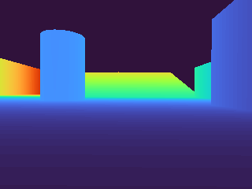

# Actual Gazebo RGB-D capture; target visibility remains NOT VERIFIED

Read [bootstrap runtime report](../../m1/validation/bootstrap_20261009/REPORT.md)
for complete source/ownership/resource/teardown provenance. Inputf85c818,
NON_QUALIFYING Dev5 startup, emergency resource abort, no manipulation attempt.

`inspect_sensor_bag.py` is an offline legitimate-sensor inspection tool. It
reads Image, CameraInfo and TF; /eval payloads are skipped. Existing colour masks
and pairing convention are reused. Images/depth arrays keep source frame/stamp;
no world/object state, fixed target height or fake lift enters inference.

3 real RGB and3 depth frames captured. All requested red masks empty; no target
pixel extent, depth region, physical centre or support geometry available.
Skew0/60/460ms: last pair invalid. Camera near-plane config unchanged; no measured
target near-plane status inferred without detected/associated target.

Previews below are startup scene evidence, **not** mandatory-phase visibility:

Complete source stamps/counts/validity/nonfinite JointState diagnosis:
[sensor_inspection.json](sensor_inspection.json). Full TF and float depth arrays
remain external, hashed by the bootstrap evidence index.

Observer/consumer NOT IMPLEMENTED; rendered feasibility gate not passed. No
placement certification, physical impossibility, successful control, system fix
or root-caused-and-fixed entry claimed. New tests address recorder encoding only.
